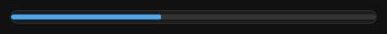
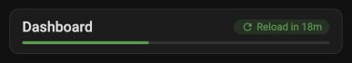
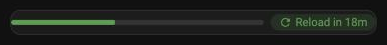
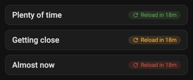

# Reload Page for Home Assistant

A dashboard card that reloads the browser page on a timer and shows the countdown as a progress bar, a title (`Reload in 16m`), or both.

Useful for wall tablets and always-open dashboards: some custom cards (charts in particular) slowly leak memory and load the CPU when a page stays open for hours, and a periodic reload brings the page back to a clean state.

## Install

1. HACS → ⋮ → **Custom repositories** → add `https://github.com/aremishevsky/ha-reload-page`, type **Integration**. On Home Assistant 2026.11 and newer, HACS is **Settings → Marketplace**: use **Add from link**.
2. Install **Reload Page** and restart Home Assistant.
3. Settings → Devices & services → **Add integration** → **Reload Page**.

The integration serves the card and loads it on every dashboard, so you don't add a dashboard resource by hand.

## Card

Edit dashboard → **Add card** → **Reload Page**. All options are in the visual editor.

| | |
|---|---|
| `display: bar` |  |
| `display: both` with a title |  |
| `display: both`, `show_title: false` |  |
| Countdown colors: more than `warn_at`% left, less than `warn_at`%, less than `alert_at`% |  |

```yaml
type: custom:reload-page-card
interval: 30                 # minutes between reloads
display: bar                 # bar | title | both
title: Page reload           # header title (title / both)
show_title: true             # false = countdown chip only (with `both`: bar and chip on one row)
label: Reload in             # countdown chip text before the time left
bar_height: 4                # px
bar_color: var(--primary-color)
bar_background: var(--divider-color)
rounded: true
background: false            # false = transparent card, no border
bar_match_chip: false        # true = bar uses the countdown colors below
warn_at: 50                  # % of the interval left: below this the countdown turns orange
alert_at: 15                 # ... and red below this
color_ok: var(--success-color, #4caf50)
color_warn: var(--warning-color, #ff9800)
color_alert: var(--error-color, #f44336)
color_paused: var(--info-color, #039be5)
```

How it works:

- The timer counts from the page load, so every card on the page shows the same countdown. With several cards, the shortest `interval` wins.
- `title` / `both` show a header: your title on the left and a countdown chip on the right. The chip is green while more than `warn_at`% of the interval is left, orange below that, red below `alert_at`%, and blue while reloading is paused. Hover it for the exact reload time; tap it to reload right away (works in edit mode too).
- Changing `interval` restarts the countdown.
- The chip shows the time left in whole minutes: `30m+` when there are more than 30 minutes left, then `29m` … `1m`, and `less 1m` in the last minute.
- The bar is a single CSS animation; nothing runs in JavaScript between title updates (once a minute).
- While the dashboard is in edit mode the page is not reloaded; the card checks again every 15 seconds.

## Reload Content card

Holds other cards and re-creates them on a timer instead of reloading the whole page. Same countdown options as the Reload Page card; inner cards go under `cards:` (edit them in the code editor).

```yaml
type: custom:reload-content-card
interval: 30                 # minutes between re-creating the inner cards
display: both
show_title: false            # bar and countdown on one row
cards:
  - type: custom:plotly-graph
    entities:
      - sensor.solar_power_total
```

- New inner cards are built first and swapped in, so the card never shows empty; the old ones are removed from the page.
- Each Reload Content card has its own countdown; tapping the chip re-creates the content right away.
- It does **not** free memory on current Home Assistant versions, see below. Use it to refresh what cards show, not as a fix for memory growth.
- `window.__reloadContentStats` counts re-creations, for measuring memory.

## Memory: what re-creating cards does and doesn't free

Measured on Home Assistant 2026.11.1 in Chrome, with `performance.memory` and `WeakRef` checks (an object counts as freed when its `WeakRef` comes back empty after the browser collects garbage).

| Test | Result |
|---|---|
| Reload Content with a Plotly Graph Card (14 traces, 24 h), re-created every minute for 15 minutes | Lowest heap between garbage collections grew from ~111 MB to ~240 MB, about **8 MB per re-creation** |
| Full page reload after that | Heap dropped from 265 MB to **93 MB**, then started growing again at the same rate |
| Old Plotly Graph Cards after re-creation (plotly-graph-card 3.8.2 and 4.0.2) | **All kept in memory**, although they were off the page and no longer redrew |
| Old built-in cards (`tile`, `entities`) after re-creation | **All kept in memory** |
| `hui-tile-card` made with `createCardElement` (or `document.createElement`), never added to the page | **All kept in memory** |
| Plain `div` and simple custom elements, same test | Freed |

What this means:

- Once a Home Assistant card element is created, something keeps a reference to it, so removing it from the page doesn't free it. This is not specific to Plotly or to this card; we didn't find what holds the reference (that needs a heap snapshot in DevTools).
- Re-creating cards therefore makes memory grow faster, not slower. The old `periodic-card-reload` approach (re-create a chart every few minutes) leaks the same way: in our test, 20 re-creations took the page from 162 MB to 397 MB.
- **A full page reload is the only thing that brings memory back.** For always-open dashboards use the Reload Page card (for example every 30 minutes) and avoid cards that re-create other cards.
